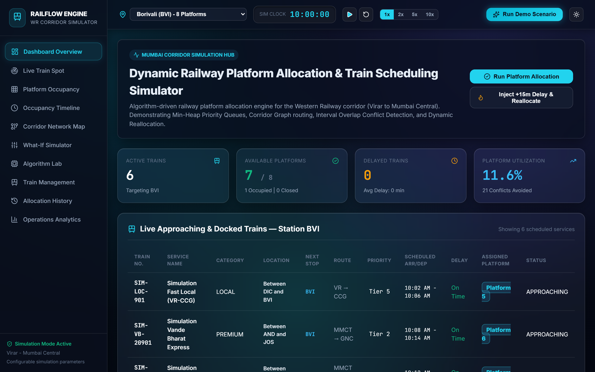
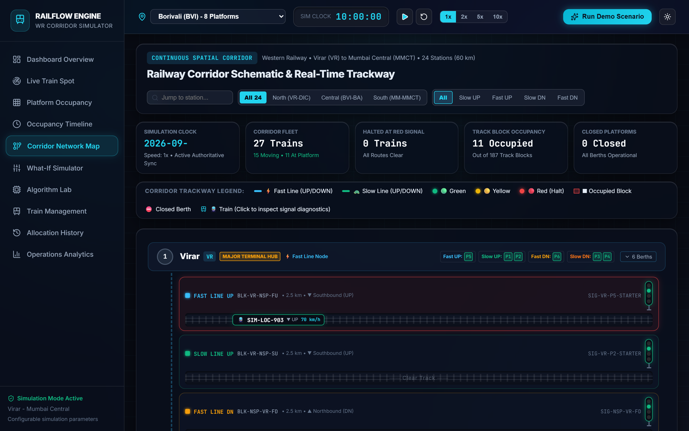
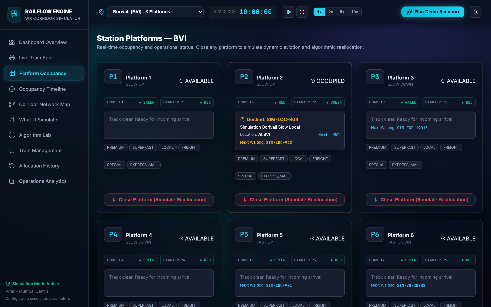

# Railway Management & Simulation System

[](https://github.com/om-rindhe24/railway-management-simulation/actions/workflows/ci.yml)
[](LICENSE)
[](https://spring.io/projects/spring-boot)
[](https://react.dev)
[](https://www.typescriptlang.org)

> A real-time, algorithmic railway traffic dispatch, platform allocation, and 4-aspect automatic signalling simulator modeling Mumbai's 24-station Western Railway corridor.

---

## Screenshots

| Live Train Spotter (Map View) | Borivali (BVI) Station Interlocking |
| :---: | :---: |
|  |  |
| **Schematic Corridor Track View** | **Platform Allocation & Live Closure View** |
|  |  |

---

## Key Features

- **Algorithmic Platform Allocation & Scoring**: Dynamic multi-criteria scoring algorithm assigns platforms based on length, physical line compatibility, occupancy buffer windows, and crossover penalty weights.
- **Dynamic Reallocation & Interlocking**: Automatic real-time failover when a platform is closed for maintenance or emergencies. Enforces strict direction preservation (UP trains remain on UP/COMMON platforms; DOWN trains remain on DOWN/COMMON platforms) and falls back to compatible lines (Slow to Fast) or holds trains safely at outer home signals.
- **Comprehensive Audit Trail**: Automatically records granular operational logs (`TRAIN_REALLOCATED` with explicit fallback reasoning, `TRAIN_HELD`, `PLATFORM_CLOSURE`, `PLATFORM_REOPENED`) persisted in relational storage and inspectable via the API.
- **Indian Railways 4-Aspect Signalling**: Realistic multi-block signalling logic (`GREEN`, `DOUBLE_YELLOW`, `YELLOW`, `RED`) regulating acceleration, caution approach speeds, and mandatory signal halts.
- **Physics-Informed Speed & Braking Curves**: Trains accelerate smoothly up to corridor track speed limits and brake realistically based on aspect visibility and platform approach limits.
- **Service Stopping Patterns**: Differentiated route handling for `SLOW_LOCAL` (all stops), `FAST_LOCAL` (skips minor halts), and `EXPRESS` / `EMERGENCY` mainline services.
- **24-Station Virar – Mumbai Central Corridor**: High-density quad-track topology (SLOW_UP, SLOW_DOWN, FAST_UP, FAST_DOWN) with intermediate signals, platform track circuits, and crossovers.
- **Turnaround Loop Execution**: Automated terminal train inversion at Virar (`VR`) and Mumbai Central (`MMCT`), enabling long-running corridor simulations without fleet depletion.
- **Interactive Leaflet & Schematic Interfaces**: Synchronized real-time UI featuring a live geographic track map, schematic ladder view, timeline Gantt charts, delay injection sandboxes, and analytical throughput dashboards.

---

## Tech Stack

| Layer | Technologies |
| :--- | :--- |
| **Backend** | Java 21, Spring Boot 3.3.4, Spring Security, Spring Data JPA, Hibernate, H2 Database / MySQL 8.0 |
| **Frontend** | React 19, TypeScript, Vite, TailwindCSS / Vanilla CSS, Leaflet, Lucide Icons |
| **Algorithms** | Graph-based Corridor Representation, Dynamic Priority Queues, Interval Conflict Detection, 4-Aspect State Machine |
| **Testing & CI** | JUnit 5, Mockito, Spring Security Test, Playwright, GitHub Actions |

---

## Architecture & Algorithm Overview

For detailed diagrams and architectural specifications, see [docs/ARCHITECTURE.md](docs/ARCHITECTURE.md).

```
                      +-----------------------------+
                      |      CorridorGraph          |
                      |  24 Stations | 4 Track Lines|
                      +--------------+--------------+
                                     |
               +---------------------+---------------------+
               |                                           |
               v                                           v
+-----------------------------+             +-----------------------------+
|    TrainPriorityQueue       |             |     SignalStateEngine       |
| Hierarchy & Delay Weighted  |             |  4-Aspect Dynamic Blocks    |
+--------------+--------------+             +--------------+--------------+
               |                                           |
               v                                           v
+-----------------------------+             +-----------------------------+
|   PlatformScoringEngine     |             |  IntervalConflictDetector   |
| Multi-Criteria Evaluation   |             |   Headway & Space-Time Cloc |
+--------------+--------------+             +-----------------------------+
               |
               v
+-----------------------------+
|  DynamicReallocationEngine  |
| Failover & Direction Guard  |
+-----------------------------+
```

1. **`CorridorGraph`**: Models the 24 stations, four running lines, intermediate signal checkpoints, and physical platform lengths.
2. **`TrainPriorityQueue`**: Evaluates trains by operational urgency: $\text{Priority} = f(\text{Category}, \text{Delay Minutes}, \text{Approaching Distance})$.
3. **`PlatformScoringEngine`**: Computes multi-attribute utility scores penalizing track switches, occupied headway margins, and incompatible stopping requirements.
4. **`DynamicReallocationEngine`**: Detects live disruption triggers (platform closures, block blockages), computes alternate feasible allocations, and writes audit history.
5. **`SignalStateEngine`**: Continuously updates signals every simulation tick based on downstream block reservations and train positions.
6. **`IntervalConflictDetector`**: Sweeps temporal reservation intervals $[T_{\text{start}}, T_{\text{end}}]$ across platforms to prevent conflicting train movements.

---

## How to Run

### Prerequisites
- **JDK 21** or later
- **Apache Maven 3.9+**
- **Node.js 20+** and **npm 10+**

### 1. Backend Setup
```bash
cd backend

# Run with development profile (H2 in-memory DB + console enabled)
mvn spring-boot:run "-Dspring-boot.run.profiles=dev"
```
The backend initializes on `http://localhost:8080`.

### 2. Frontend Setup
```bash
cd frontend

# Install dependencies
npm install

# Start Vite development server
npm run dev
```
The frontend application opens on `http://localhost:5173`.

### Environment Variables & Credentials

| Variable | Scope | Default (Dev Profile) | Production Recommendation |
| :--- | :--- | :--- | :--- |
| `SIMULATOR_API_KEY` | Backend | `railway-dev-key-2026` | Generate high-entropy 64-char hex key |
| `ADMIN_USERNAME` | Backend | `admin` | Custom administrative username |
| `ADMIN_PASSWORD` | Backend | `dev-admin-pass` | Secure cryptographic password |
| `CORS_ALLOWED_ORIGINS` | Backend | `http://localhost:5173` | Trusted production web domain |
| `VITE_API_KEY` | Frontend | `railway-dev-key-2026` | Matches `SIMULATOR_API_KEY` |

> [!NOTE]
> All mutating and administrative endpoints (platform close/open, simulation start/speed/reset, train CRUD, delay injection) require authentication via the `X-API-KEY` header or HTTP Basic Auth. Read-only endpoints used for the corridor telemetry and live map remain public.

---

## How to Run Tests

### Backend Unit & Integration Tests
```bash
cd backend
mvn clean test
```
The suite executes **95 comprehensive tests** verifying algorithm correctness, 4-aspect signal cascades, platform direction invariants, live failover reallocations, and security authorization filters.

### Frontend Validation
```bash
cd frontend
npm run build
```

---

## Main REST API Endpoints

| Method | Endpoint | Access | Description |
| :--- | :--- | :--- | :--- |
| `GET` | `/api/corridor/state` | Public | Full corridor snapshot (trains, blocks, signals, active allocations) |
| `GET` | `/api/stations` | Public | List all 24 stations along the Virar–Mumbai Central corridor |
| `GET` | `/api/stations/{code}/platforms`| Public | Fetch platforms, line types, and status for a specific station |
| `GET` | `/api/history` | Public | Audit log of allocation changes, reallocations, and held trains |
| `GET` | `/api/analytics` | Public | Corridor KPIs: active fleet count, punctuality rate, headway averages |
| `GET` | `/actuator/health` | Public | Application health telemetry |
| `POST`| `/api/simulation/start` | Secured | Start the real-time physics and signalling clock |
| `POST`| `/api/simulation/pause` | Secured | Pause simulation tick execution |
| `POST`| `/api/simulation/speed` | Secured | Set simulation time multiplier (1x to 10x) |
| `POST`| `/api/simulation/reset` | Secured | Reset corridor state and reseed baseline schedule |
| `POST`| `/api/platforms/{id}/close` | Secured | Close a platform for maintenance with reason |
| `POST`| `/api/platforms/{id}/open` | Secured | Reopen platform and resume scheduled allocations |
| `POST`| `/api/trains/{id}/delay` | Secured | Inject simulated signal/operational delay (minutes) |

---

## Honest Limitations

- **Synthetic Timetables & Assumptions**: While station names, sequence orders, and quad-track directions mirror the Western Railway corridor, scheduled timetables, headway intervals, and platform-to-line assignments are simulation models rather than official Indian Railways working time tables (WTT).
- **Not Production Rail Hardened**: Designed for dispatch research, simulation modeling, and educational demonstration. It is not an SIL-4 certified safety-critical railway interlocking system.
- **OpenStreetMap Attribution**: Geographic map tiles are rendered using [OpenStreetMap](https://www.openstreetmap.org/copyright) contributors, available under the Open Database License (ODbL).

---

## What I Learned

1. **Safety Interlocking Invariants**: Enforcing strict direction preservation (UP vs DOWN) during real-time failovers is critical; a naive scoring algorithm might find an idle opposite-direction platform that would cause a face-to-face deadlock or derailment risk.
2. **Tick-Based Physics & Discrete Events**: Coordinating continuous kinematics (acceleration, braking distance) with discrete 4-aspect block signals requires deterministic tick loops to prevent trains from overshooting occupied blocks.
3. **Defense-in-Depth for Dispatchers**: Hardening operational APIs with tokenized authentication, strict bean validation, and masked error traces prevents malicious or malformed disruption triggers in transport dispatch consoles.

---

## License

This project is licensed under the [MIT License](LICENSE) - Copyright (c) 2026 OM Rindhe.
