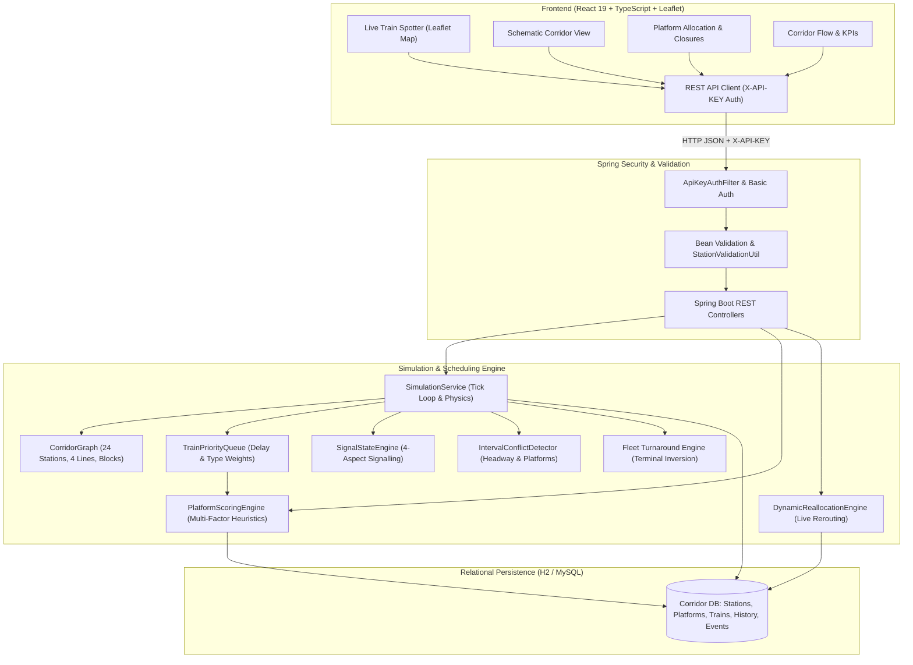

# System Architecture

The **Dynamic Railway Platform Allocation & Train Scheduling Simulator** is engineered as a high-fidelity, real-time railway operations and signalling engine modelling the 24-station Western Railway corridor between Virar (VR) and Mumbai Central (MMCT).

---

## Core Algorithmic Components

### 1. CorridorGraph
- Encapsulates the complete track network across 24 stations.
- Models 4 distinct railway lines:
  - **SLOW_UP**: Virar towards Mumbai Central (Stopping at all stations).
  - **SLOW_DOWN**: Mumbai Central towards Virar (Stopping at all stations).
  - **FAST_UP**: Virar towards Mumbai Central (Skipping minor halts).
  - **FAST_DOWN**: Mumbai Central towards Virar (Skipping minor halts).
- Manages consecutive track blocks between stations with spatial kilometer offsets, speed limits, and signal checkpoints.

### 2. TrainPriorityQueue
- Implements dynamic priority ordering for trains approaching junctions and stations.
- Hierarchy:
  $$\text{Priority Rank} = f(\text{Category}, \text{Delay Minutes}, \text{Distance to Signal})$$
  1. `EMERGENCY`: Immediate track clearance.
  2. `EXPRESS`: High-speed mainline preference.
  3. `FAST_LOCAL`: Scheduled corridor throughput.
  4. `SLOW_LOCAL`: Local transit services.

### 3. PlatformScoringEngine
- Evaluates candidate platforms for approaching trains using a multi-criteria scoring algorithm:
  - **Compatibility**: Verifies physical length, electrification, and train type capabilities.
  - **Direction & Line Preservation**: Strongly prioritizes same-direction platforms matching the current running line (Slow vs Fast).
  - **Occupation & Buffer**: Ensures headway buffers between departing and arriving trains.
  - **Turnaround Suitability**: Evaluates crossover availability for turnaround services at terminals (`VR` and `MMCT`).

### 4. DynamicReallocationEngine
- Handles real-time platform closures due to maintenance, track failures, or emergency conditions.
- Preserves train operational direction (UP trains stay on UP/COMMON platforms; DOWN trains stay on DOWN/COMMON platforms).
- Generates detailed, human-readable audit records in `allocation_history`:
  - `TRAIN_REALLOCATED`: Identifies old platform, new platform, and explicit failover reasoning (e.g., fallback from primary line to secondary same-direction line).
  - `TRAIN_HELD`: Safely holds the train at the outer home signal if all compatible platforms are closed or occupied.

### 5. SignalStateEngine (4-Aspect Signalling)
- Implements standard Indian Railways 4-aspect automatic block signalling:
  - **GREEN**: 2+ blocks ahead are clear (Full speed: up to 100 km/h).
  - **DOUBLE_YELLOW**: Next block clear, second block occupied (Caution: 50 km/h max).
  - **YELLOW**: Immediate next block occupied (Attention: 25 km/h max, prepare to stop).
  - **RED**: Block ahead is occupied (Danger: Mandatory halt at signal, 0 km/h).

### 6. IntervalConflictDetector
- Continuously scans platform occupancy intervals and block headway intervals to prevent rear-end collisions and simultaneous platform assignments.

---

## Security & Hardening Architecture

1. **Authentication Gateway**:
   - `ApiKeyAuthFilter` checks the `X-API-KEY` header against configured environment variables (`SIMULATOR_API_KEY`).
   - HTTP Basic Authentication is available for automated pipelines and administrative tooling.
   - Public read-only endpoints (`GET /api/**`, `/actuator/health`) allow unrestricted map monitoring and status telemetry.
2. **Network Isolation**:
   - Default profile binds strictly to localhost (`127.0.0.1`).
   - Explicit CORS policy permits only trusted frontend origins without wildcards (`http://localhost:5173`).
3. **Information Disclosure Prevention**:
   - Stack traces and internal server exception messages are masked (`include-stacktrace=never`, `include-message=never`).
   - Actuator endpoints restricted to `health` only.
   - H2 database console is disabled in production configurations.
4. **Input Defense**:
   - Bean Validation (`@Valid`, `@Size`, `@Min`, `@Max`, `@NotBlank`) on all mutation request bodies.
   - Strict corridor station validation prevents arbitrary SQL or parameter injections.
